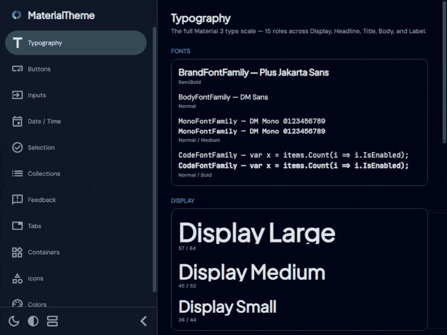

# CCSWE.Avalonia.Material

[](https://github.com/ccswe-avalonia/CCSWE.Avalonia.Material/actions/workflows/dotnet-build-library.yml)
[](https://www.nuget.org/packages/CCSWE.Avalonia.Material)
[](https://www.nuget.org/packages/CCSWE.Avalonia.Material)
[](LICENSE.md)

A standalone **Material 3** theme for [Avalonia](https://avaloniaui.net) 12 — a
color system with Dark, Light and high-contrast variants, the M3 type scale, motion,
embedded fonts, and M3
control themes across the full surface: buttons (toggle/split/dropdown/hyperlink +
command bar + floating action button), text fields, autocomplete, numeric steppers, selection controls,
lists, tree views, dropdowns, menus, expander, cards, badges, group boxes, dividers, sliders,
progress (linear + circular), tabs (tab control + tab strip), pips pager, tooltips, notifications, the
date family (calendar, date/time pickers), page shells, and a navigation drawer +
rail (`DrawerPage`). It depends only on **Avalonia core** — no
`FluentTheme`/`SimpleTheme` base required; it supplies the whole control surface itself.

It is the desktop sibling of the CCSWE **web** and **Android** libraries — all three
consume the same shared cross-platform design tokens, which the CCSWE design system
generates into this library's Avalonia `ResourceDictionary` + `Styles` token files.
The library ships them, with its control themes, as a NuGet package.



## Install & wire up

```sh
dotnet add package CCSWE.Avalonia.Material
```

> **Versioning:** the **major version tracks the supported Avalonia major** — `12.x`
> targets **Avalonia 12.x**. Pick the major that matches your Avalonia version; minor/patch
> are this library's own features and fixes.

Then add one element to your `App.axaml` (full sample in
[`docs/samples/App.sample.axaml`](docs/samples/App.sample.axaml)):

```xml
<Application xmlns="https://github.com/avaloniaui"
             xmlns:x="http://schemas.microsoft.com/winfx/2006/xaml"
             xmlns:theme="using:CCSWE.Avalonia.Material"
             x:Class="YourApp.App"
             RequestedThemeVariant="Dark"> <!-- Dark is the CCSWE default -->

  <Application.Styles>
    <theme:MaterialTheme />
  </Application.Styles>
</Application>
```

`MaterialTheme` is standalone — it supplies the whole control surface itself and
depends only on Avalonia core. **No `<FluentTheme/>` or other base theme is required.**

## Use it

```xml
<StackPanel Spacing="12">
  <TextBlock Classes="HeadlineSmall" Text="Devices" />
  <TextBox Classes="Outlined" PlaceholderText="IP address" />
  <Button Classes="Filled" Content="Connect" />
  <Button Classes="Outlined" Content="Pair new device" />
  <CheckBox Content="Connect automatically" />
  <ToggleSwitch Content="Wireless debugging" />
  <Button Classes="Text" Content="Cancel" />
</StackPanel>
```

- **Buttons:** `Filled`, `FilledTonal`, `Elevated`, `Outlined`, `Text`, `Icon`, `Destructive`.
- **Floating action button:** the `<theme:FloatingActionButton>` control — `Size` (`Small` / `Regular` / `Large`) and `Color` (`Primary` / `Secondary` / `Tertiary` / `Surface`) M3 mappings, with `Command` / `Click` inherited from `Button`.
- **Text fields:** `Outlined`, `Filled`.
- **Cards:** the `<theme:Card>` control for interactive cards — `Elevated` / `Filled` / `Outlined` classes, M3 hover/press state layers, and `Command` / `Click` (clickable when a `Command` is set, or `IsClickable="True"`). For a static surface, a plain `Border` with `Card` + `Elevated` / `Filled` / `Outlined` still works.
- **Divider:** the `<theme:Divider>` control — a thin M3 rule that separates content. An optional `Header` turns it into a leading section header (the label sits on the rule's axis with the hairline filling the width to its right); omit it for a plain full-width rule.
- **Badge:** the `<theme:Badge>` control — an M3 badge for counts and status: a 6dp dot with no content, a 16dp pill with a label (e.g. `Content="3"`). Place it on an icon as the last child of `<theme:BadgedPanel>`, which pins it to the top-right corner. It uses `ErrorFill` / `OnErrorFill`; set `Background` / `Foreground` (a fill pair such as `PrimaryFill` / `OnPrimaryFill`) for another color.
- **Navigation:** a `DrawerPage` shell with a `ListBox Classes="NavigationDrawer"` of destinations, or `Classes="NavigationRail"` for the compact 80dp rail (the active destination gets the M3 indicator pill).
- **Circular progress:** the `<theme:CircularProgressIndicator>` control — determinate (`Value` / `Minimum` / `Maximum`) or an `IsIndeterminate="True"` spinner; the ring counterpart to the linear `ProgressBar`.
- **Default-themed (no class needed):** `ToggleButton`, `AutoCompleteBox`,
  `NumericUpDown`, `CheckBox`, `RadioButton`, `ToggleSwitch`, `ListBox`, `TreeView`,
  `ComboBox`, `Menu`, `Expander`, `Slider`, `ProgressBar`, `TabControl`, `TabStrip`.
- **Type scale:** `DisplayLarge … LabelSmall` as `TextBlock` classes.
- **Color roles:** `{DynamicResource Primary}` (brush) / `{DynamicResource PrimaryColor}`
  (color), including the fill pairs (`PrimaryFill` / `OnPrimaryFill`, `ErrorFill` /
  `OnErrorFill`) for filled controls, `Accent` / `AccentStrong` for links, and the
  `Success` / `Warning` / `Info` status roles. Use `DynamicResource` for role brushes so
  they re-resolve when the theme variant changes; `StaticResource` is fine for the
  theme-invariant metrics (`CornerRadius*`, `Spacing*`, `Motion*`).
- **Fonts:** `BodyFontFamily`, `BrandFontFamily`, `MonoFontFamily` and `CodeFontFamily`
  (`{DynamicResource CodeFontFamily}`), embedded in the package.
- **Icons:** the theme's glyphs are [Google Material Symbols](https://fonts.google.com/icons)
  (Outlined), shipped as `StreamGeometry` resources keyed `Material_Icon*`
  (e.g. `Material_IconClose`, `Material_IconChevronRight`). Use any in your own UI via
  `<PathIcon Theme="{DynamicResource Material_SymbolTheme}" Data="{DynamicResource Material_IconMenu}" />`
  (`Material_SymbolTheme` keeps Material's icon padding; size it to the slot, 24 by default),
  or override one for your app by redefining the same key downstream.

### Switching theme variant

Dark is the CCSWE default. The variants are `ThemeVariant.Dark`, `ThemeVariant.Light`,
`MaterialTheme.DarkHighContrast` and `MaterialTheme.LightHighContrast`. Switch at
runtime — the `ThemeDictionaries` do the rest:

```csharp
Application.Current!.RequestedThemeVariant = MaterialTheme.DarkHighContrast;
```

In XAML, a high-contrast variant is an `x:Static` reference:

```xml
<Application ... RequestedThemeVariant="{x:Static theme:MaterialTheme.DarkHighContrast}">
```

The theme doesn't follow the operating system's high-contrast setting; the app chooses
the variant.

## Repository layout

```
src/
  CCSWE.Avalonia.Material/        the theme library (NuGet package)
    MaterialTheme.axaml(.cs)   the <theme:MaterialTheme/> entry (add this to App.axaml)
    Tokens.axaml               color roles per theme variant + metrics + M3 font sizes
    Fonts.axaml                embedded FontFamily resources
    Motion.axaml               durations + easings
    Typography.axaml           M3 type-scale TextBlock classes
    Controls/*.axaml           M3 control themes (hand-authored)
    *.cs                       custom control types (Card, Divider, ...; most controls theme stock Avalonia)
    Base/*.axaml               interim control base (forked from Simple 12.0.4)
    Assets/Fonts/              embedded OFL TTFs (fetch-fonts.sh / .ps1)
  CCSWE.Avalonia.Material.Demo/   gallery app — visual verification harness
  CCSWE.Avalonia.Material.UnitTests/  headless NUnit tests
docs/                          M3 conformance audit, GUI debugging, tasks
docs/samples/                  App.axaml wiring sample
```

The token files (`Tokens.axaml` / `Typography.axaml` / `Motion.axaml` / `Fonts.axaml`)
are **generated by the CCSWE design system** from the shared cross-platform tokens —
never hand-edit them. The library **owns** everything else: the `MaterialTheme` entry,
all `Controls/*` M3 themes, the `Base/*` infrastructure, the font bytes, the custom
control types (e.g. `Card`), and packaging. See [`CLAUDE.md`](CLAUDE.md) for the full
contract.

## Build & run

```bash
# Build everything
dotnet build src/CCSWE.Avalonia.Material.slnx -c Release

# Run the gallery (theme, contrast and density toggles + every themed control)
dotnet run --project src/CCSWE.Avalonia.Material.Demo

# Pack the library
dotnet pack src/CCSWE.Avalonia.Material/CCSWE.Avalonia.Material.csproj -c Release
```

Requires the .NET SDK pinned in `global.json`.

## License

The library is under [`LICENSE.md`](LICENSE.md). The embedded fonts and icons are
listed in [`THIRD-PARTY-NOTICES.md`](THIRD-PARTY-NOTICES.md); their license files ship
alongside them in `src/CCSWE.Avalonia.Material/Assets/`.
